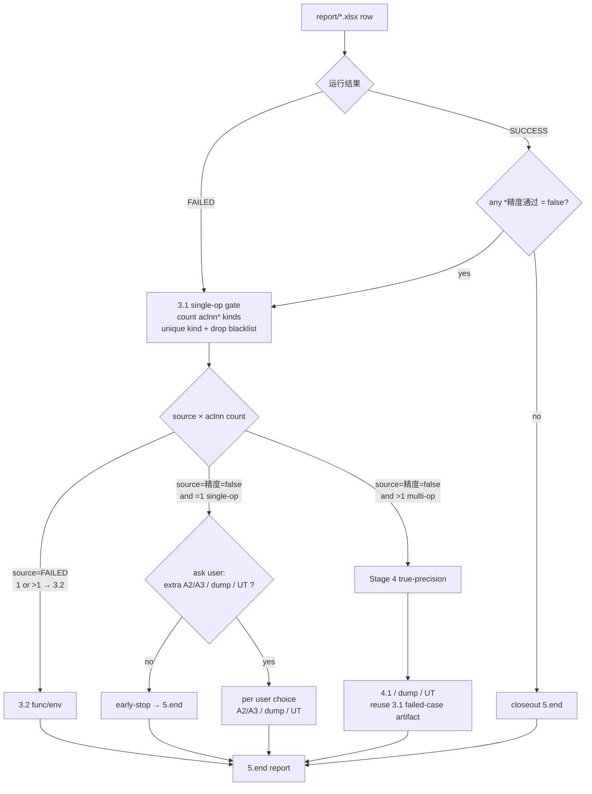

# ATK Master Flow (Branch A)

> **Scope**: only when the orchestrator has passed Gate 0 (inputs: CANN ATK case dir + op-plugin repo root). This doc covers the full skeleton from env setup → xlsx row attribution → closeout. **xlsx source decided at Stage 2**: existing PTA ATK artifact (`report/*.xlsx` + tee) → Rule 0 skips adapt+run; else run adapt+run to produce.
> **Division**: orchestrator = routing + contract + global policy; this doc = ATK skeleton; tools/ + op-atk-adapt = operational detail.
> **Policy**: non-paste evidence (DTS/heaven/wiki/screenshots) follows [hard-constraints · 统一口径](../knowledge/hard-constraints.md#统一口径--外部资源获取方式).
> **Pitfalls**: precision/dump/dual-baseline/determinism — see [gotchas](../knowledge/gotchas.md).

---

# Part 1. Step Mainline

Proceed Stage 0→1→2→3→4→5.end. Each step shows evidence (`case_id` / `运行结果` / precision col name / `aclnn` count / failure summary). Attribution unstable after two rounds → Read matched tool full text (see "Two-strike rule" in Part 2).

## Precondition · Gate 0 Contract

1. Complete the [opening contract · Branch A](op-delimitation-orchestrator/SKILL.md#开场契约gate-0-通过后阻塞后续) (fields: [intake-contract.md](../knowledge/intake-contract.md)).
2. Contract not met → list missing, stop. No execution/conclusion before contract.

## Stage 0 · Env Baseline (before ATK)

`unset http_proxy https_proxy` + `export ATK_BIND_CPU_TYPE=2`; proxy only for download. Authority: [op-atk-adapt · env baseline](../tools/op-atk-adapt/SKILL.md).

## Stage 1 · NPU Access (narrow optional)

Default local (repo+NPU same machine). Only when repo+NPU both remote: Read [manual-connect-npu-server](../tools/manual-connect-npu-server/SKILL.md), apply per `config/remote-config.yaml`, record `remote_torch_npu_dir` / `remote_torch_npu_version`. **Not supported**: local pta + remote NPU (see [hard-constraints](../knowledge/hard-constraints.md)).

## Stage 2 · Adapt + Run (flow rule)

> **Gate before scale**: pass Rule 0 first (adapt+run needed?), then Rule 1/2 (how many). Detail: [op-atk-adapt](../tools/op-atk-adapt/SKILL.md).

### Rule 0: Gate — existing xlsx + tee skips adapt+run

User provides PTA ATK xlsx path + tee path (artifact exists) → **skip adapt+run** (no auto_adapt / atk case / executor patch / atk task), go straight to Stage 3 row attribution. Precedes Rule 1/2, so existing artifacts never mistakenly enter the adapt flow.

### Adapt steps (no xlsx)

`auto_adapt → atk case（条件步骤：模式 B/3file 传入 case.json 时跳过，4 步→3 步）→ patch executor → atk task`（模式 B 的 `-c` = 传入的 case.json；模式 A = `result/<api_type>.json`）(`-mt`/`-to` evidence-driven). No xlsx → follow until `atk_output/.../report/*.xlsx` (+ tee). Two rounds no main path → Two-strike rule forces Read op-atk-adapt full text.

### Rule 1: cases > 500 → `-e 50` quick check

case_json count > 500 (or unknown) → **prefer** `-e 50` first 50 cases:

- 50 SUCCESS + precision pass → only then ask whether to run full
- any FAILED / precision fail → enough samples for 3.1/3.2/4, no full run
- `-e` composable with `-wl`/`-bl`/`-sd`/`-mt`/`-to`

### Rule 2: full run (>500 cases) only when

1. 50-case quick check all pass + user explicitly requests full
2. case_json count ≤ 500

## Stage 3 · Row-level Attribution

> **Precondition**: xlsx produced by [op-atk-adapt](../tools/op-atk-adapt/SKILL.md) adapt + run (`atk_output/all_<api_type>_<ts>/report/*.xlsx`). Argument that both column-structure compatibility and the 3.1 gate `TORCH_NPU_LOGS=op_plugin` still hold under the PTA executor: [seam-argument](../tools/op-atk-adapt/reference/seam-argument.md).
>
> **Read method**: must use [op-atk-adapt xlsx parser](../tools/op-atk-adapt/SKILL.md#读-xlsx中文表头--中文单元格的解析模板权威单一展开点) (Python); `cat/grep/xlsx2csv` direct read unusable.

Read `atk_output/<CaseSet>_<ts>/report/*.xlsx` **by row**. **Has xlsx → take attribution rows** (`FAILED` or `SUCCESS+精度=false`) → **3.1 single-op gate first**:

> **3.1 is a precondition gate (not optional)**: any row `运行结果=FAILED` or `SUCCESS + any *精度通过=false` → first enter [analyze-single-op](../tools/op-delimitation-analyze-single-op/SKILL.md) (set `TORCH_NPU_LOGS=op_plugin` + `-wl '[case_id]'` single run → get `aclnn` kind count per "aclnn counting" in Part 2). **After 3.1, branch by "source × op-count"**:
>
> - **Source = `FAILED` (func/env)** → single or multi → **3.2**; single-op **not** early-stop (aclnn error / A2/A3 known issues / env issues still need 3.2).
> - **Source = `SUCCESS+精度=false` and `aclnn`=1 (single-op)** → before 5.end **ask user**: "extra analysis (A2/A3 / dump / UT) before closeout?"; no → early-stop to 5.end; yes → do chosen then 5.end, write basis in md (see [API-aclnn-mapping](https://gitcode.com/yashi999/Ascend-AI-Frame-Agent-Skills/blob/main/skills/API-aclnn-mapping/SKILL.md) as auxiliary only).
> - **Source = `SUCCESS+精度=false` and `aclnn`>1 (multi-op)** → **Stage 4 true-precision**; 4.1 reuse 3.1 failed-case table + `--save_data` artifact.
> - **`SUCCESS` + all *精度通过=true** → not 3.1, treat as closeout.

### One-screen decision table

| Condition (per row) | Main path | Aux / relation to 3.1 |
|---|---|---|
| `运行结果`=`FAILED` | **3.2** ([functional](../tools/op-delimitation-analyze-functional/SKILL.md)) | **3.1 done first**; **single-op not early-stop** — continue 3.2; reuse 3.1 failed-case artifact after 3.2 |
| `运行结果`=`SUCCESS` and a `*精度通过` col=false | **Stage 4 precision** ([precision](../tools/op-delimitation-analyze-precision/SKILL.md)) | **3.1 done first**; **single-op ask user about A2/A3/dump/UT first**, else early-stop; multi-op → this path 4, 4.1 reuse 3.1 `--save_data` |
| Need aclnn count / single-op / memory-stomp delimitation | **3.1** ([single-op](../tools/op-delimitation-analyze-single-op/SKILL.md)) | 3.1 gate internal; provides aclnn count + single/multi judgment for above two |

## Stage 4 · True-precision (multi-op)

Source = `SUCCESS+精度=false` and `aclnn`>1 → this stage. 4.1 reuse 3.1 failed-case table + `--save_data`. Authority: [analyze-precision](../tools/op-delimitation-analyze-precision/SKILL.md).

## Stage 5.end · Closeout

Write closeout md when classification + evidence ready. **≠** `atk task success!`. Authority: [report](../report/op-delimitation-report/SKILL.md). Pass "Closeout gate checklist" in Part 2 first.

> **Delimit → flow-fix handoff**: if delimit tag hits a fixable (single-op 3.1 / func·env→aclnn class / composite precision / suspected adapter-layer precision defect), enter [flow-fix](op-delimitation-flow-fix.md) (invoked by op-delimitation main-control, **never self-start**); closeout only after regression PASS or circuit-breaker trip; tags: [orchestrator sub-routing](op-delimitation-orchestrator/SKILL.md#次级路由--定界--flow-fix修复子流程).

---

# Part 2. Reference

## Attribution Conventions

- **xlsx read**: Chinese header cells → **only** op-atk-adapt **python(openpyxl/pandas)**; `grep/cat` on binary forbidden.
- **ATK cmd from op-atk-adapt 4 steps** (not user paste): `-wl/-bl/-mt/-to/--save_data` per evidence; `-c/-n/-p` paths keep op-atk-adapt values ([adjustable scope](../tools/op-atk-adapt/SKILL.md)).
- **aclnn counting**: branching by `aclnn` kind count (=1 single-op / >1 multi-op). **5 aux op representatives** (excluded): `aclnnInplaceCopy*`(copy/mem) / `aclnnContiguous*`(layout/shape) / `aclnnCast*`(cast) / `aclnnFill*`(fill/init) / `aclnnStreamSynchronize*`(sync/stream). Full 9-class list + fwd/rev dedup rules: [single-op §3.1.1](../tools/op-delimitation-analyze-single-op/SKILL.md#311-计数规则) (sole authority). Count result (unique kind list + dropped blacklist items) → 3.1 single-run md / summary; closeout md too.
- **tee/csv_report**: log `save result excel file:` locates xlsx; `acc_pass_result:Failed` is summary only — **row-level prevails**.

## Flow Control · Two-strike Rule

> **Goal**: close at main-flow layer first; avoid unfolding all three analyze SKILLs upfront.

| Counter | "once" = | threshold action |
|---|---|---|
| **same decision point** | one round of reasoning/action (or one traceable tuning) done, conclusion still can't pick a path | **two consecutive rounds** → must **Read matched SKILL full text** and follow |

**Decision-point examples**:

- "contract met, need a re-run / tune tee to get `report/*.xlsx`?";
- "has xlsx: row → 3.2 func/env vs 4 precision, or just 3.1 single-op?";
- "FAILED + OOM/timeout: which `-mt/-to` tier first, then re-judge?";
- "early-stop to closeout or need 4.1 / dump?".

**Sink mapping (two-strike fail → Read full)**:

| Blocker | "once" = | threshold action |
|---|---|---|
| `auto_adapt.py` fail | one round on `cann_dir`/`project_root`, still broken | Read [op-atk-adapt](../tools/op-atk-adapt/SKILL.md) full |
| `CHECKLIST.md` missing / opName extract fail | tried asking user for opName / checking format, still fail | Read [op-atk-adapt](../tools/op-atk-adapt/SKILL.md) §cross-repo paths + fallback |
| executor patched, `atk task -e 1` fail | one round of executor.py npu-branch rewrite based on `_op_plugin_docs.py` interface prototype, single case still FAIL | Read [op-atk-adapt](../tools/op-atk-adapt/SKILL.md) §step-3 template + §3 full |
| `atk task` full run OOM/timeout | one round of `-mt`/`-to` tuning based on xlsx failure reasons, still FAIL | Read [op-atk-adapt](../tools/op-atk-adapt/SKILL.md) §`-mt`/`-to` evidence table + [atk-tuning-cases](../references/atk-tuning-cases.md) |
| has xlsx, row attribution stuck | one round on xlsx, still can't pick 3.1/3.2/4 | Read matched [analyze-single-op](../tools/op-delimitation-analyze-single-op/SKILL.md) / [analyze-functional](../tools/op-delimitation-analyze-functional/SKILL.md) / [analyze-precision](../tools/op-delimitation-analyze-precision/SKILL.md) full |

**Forbidden**: unfold whole tool into chat before two-strike; or rely on memory fragments (not full Read) after threshold.

**Case library**: row attribution stuck → check [history.md](../knowledge/history.md) (~130-case API root-cause/conclusion detail library) first — give user **search terms** (API + symptom), hit saves tool-read context. Downstream analyze-functional/precision, report 5.end use its "flow handoff" table.

## Stage↔SKILL Map

| Stage | what this layer does | authority SKILL |
|---|---|---|
| 0 · env baseline | `unset http_proxy` + `export ATK_BIND_CPU_TYPE=2` | [op-atk-adapt](../tools/op-atk-adapt/SKILL.md) |
| 1 · NPU access (narrow opt) | default local; repo+NPU both remote → manual-connect | [manual-connect-npu-server](../tools/manual-connect-npu-server/SKILL.md) |
| 2 · adapt+run | auto_adapt → atk case（模式 B/3file 跳过）→ patch executor → atk task（`-c` 按模式） | [op-atk-adapt](../tools/op-atk-adapt/SKILL.md) |
| 3.1 · single-op | aclnn count + single/multi judgment + memory-stomp falsification | [analyze-single-op](../tools/op-delimitation-analyze-single-op/SKILL.md) |
| 3.2 · func/env | aclnn error / A2/A3 known issues / env issue classification | [analyze-functional](../tools/op-delimitation-analyze-functional/SKILL.md) |
| 4 · true-precision | multi-op precision path + dump/UT | [analyze-precision](../tools/op-delimitation-analyze-precision/SKILL.md) |
| 5.end · closeout | write closeout md when classification+evidence ready | [op-delimitation-report](../report/op-delimitation-report/SKILL.md) |

## Glossary

- **5.end**: classification state ready for report; ≠ `atk task success!`.
- **early-stop**: skip rest of main analysis → 5.end, write basis in md. **two triggers only**:
  - precision single-op (source=`SUCCESS+精度=false` and `aclnn`=1) → before 5.end **ask user** about extra (A2/A3 / dump / UT); no → closeout, yes → do chosen then closeout.
  - 3.2 locked functional conclusion → can skip 4.
- ⚠ **not** early-stop: **`FAILED` single-op** — continue 3.2, no direct closeout.

## ATK · Closeout Gate Checklist

On top of orchestrator **[general]** gate:

- [ ] tee `运行日志/pta_atk_*.log` exists + `report/*.xlsx` at real path.
- [ ] **PTA ATK executor has npu branch + `atk task -e 1` single-case verified** (op-atk-adapt step 3-4).
- [ ] decision-table branching correct; `FAILED` vs `SUCCESS+精度=false` not confused.
- [ ] `-wl`/case_id matches xlsx; no on-screen guessing.
- [ ] every attribution row (`FAILED` or `SUCCESS+精度=false`): **3.1 gate done first** — `TORCH_NPU_LOGS=op_plugin` set, `-wl '[case_id]'` single-run artifact on disk, `aclnn*` **kind count** in md.
- [ ] aclnn count per [single-op §3.1.1 three-step](../tools/op-delimitation-analyze-single-op/SKILL.md#311-计数规则); md records **unique kind list + dropped blacklist items**; not `grep aclnn` hits as count.
- [ ] before 5.end: if row source=`SUCCESS+精度=false` and `aclnn`=1 (precision single-op early-stop), **asked user in writing** about A2/A3 / dump / UT; user choice + reason in md; if "yes", artifact path also in md.

## ATK · Anti-patterns

1. **guess case_id from scroll**: xlsx + python only.
2. **`atk task success!` → skip table**.
3. **treat FAILED as precision, SUCCESS+精度=false as total fail**.
4. unfold whole tool before two-strike — **wastes context**; after threshold not Read full — **violation**.
5. **remote overstep** (project-wide hard-constraint · ref): remote `pip install/uninstall` / `conda env create` / `apt` / `yum` to "fix deps", edit `~/.bashrc` / `set_env.sh` to "skip manual sourcing", `rm -rf` old `atk_output/` to "free space", restart/rebuild container, upgrade/downgrade torch_npu/cann/driver — all hit [hard-constraints · remote readonly · forbidden](../knowledge/hard-constraints.md#远端只读边界). **Right**: write env todos into `运行记录.md`, user acts; assistant only within "pta subdir write artifact + current shell temp env".
6. **skip 3.1 gate, jump to 3.2/4**: forces precision-single-op-early-stop task onto multi-op dump/UT path — wastes context + machine time; any 3.2/4 row needs 3.1 `aclnn` count evidence first.
7. **treat FAILED single-op as early-stop → closeout**: FAILED single-op **still needs 3.2** — aclnn error / A2/A3 known issues / env issue classified in 3.2 by error keyword; "only 1 op" is no excuse to skip func/env. Also: **precision single-op early-stop without asking user** is anti-pattern.
8. **first-run xlsx has failed rows → full re-run**: use `-wl '[failed case_id]'` focused single-run, not blind full re-run. Right: extract failed `case_id` from first xlsx → `-wl` focused → add `-mt`/`-to` as needed.
9. **`grep aclnn` hits as `aclnn count`**: counting not per [single-op §3.1.1](../tools/op-delimitation-analyze-single-op/SKILL.md#311-计数规则) (unique dedup + drop aux-op blacklist + fwd/rev dedup). Either same-name aclnn repeating in a loop / framework aux ops inflate the count to `>1` → wrongly pushed to **4 precision**; or the reverse — real multi-unique-kind reduced to 1 after blacklist drop → wrongly early-stopped to closeout. **Counting authority: [single-op §3.1.1](../tools/op-delimitation-analyze-single-op/SKILL.md#311-计数规则)**; md must record unique kind list + dropped blacklist items — only then is the counting evidence complete.
10. **terminal symptom as root cause / memory-stomp as universal cause**: see xlsx `失败原因`=`FileNotFoundError: input.bin not exists` / `accuracy dc failed` → "celery race / memory stomp", **without backtracking `atk_output/.../log/atk.log` earlier `EZ*` / `Unsupported_Operator` / `build op model failed`**. Real chain: op unsupported dtype → crash → ATK `cleanup case artifacts` (normal cleanup, deletes input.bin) → terminal `FileNotFoundError`. **Any "memory stomp" must pass [single-op falsify gate](../tools/op-delimitation-analyze-single-op/SKILL.md#内存踩踏证伪门) three conditions**; `FileNotFoundError` row must backtrack atk.log (see [functional terminal-symptom backtrack](../tools/op-delimitation-analyze-functional/SKILL.md#末端症状回溯)).

## Info Insufficient

List missing fields (`xlsx` path, failed `case_id` excerpt, etc.); **no fake paths**. A2/A3: prompt user to self-search.
