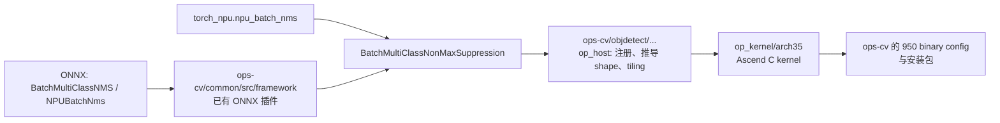
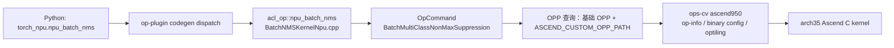

# BatchMultiClassNonMaxSuppression 的 Ascend 950 后端落地方案

## 1. 结论

该算子的 Ascend 950 后端应落在 **`ops-cv`**，建议目录为：

```text
ops-cv/objdetect/batch_multi_class_non_max_suppression/
```

不在 `canndev` 增加 950 kernel、tiling 或 binary config。`canndev` 中的同名实现只作为旧平台行为、边界条件和回归结果的参考来源。

### 当前分支实现状态

本方案已在分支 `feat/ascend950-batch-multiclass-nms` 落地功能优先的 950 后端，代码位于：

```text
ops-cv/objdetect/batch_multi_class_non_max_suppression/
```

已包含 OpDef、shape 推导、Ascend 950 `arch35` tiling、Ascend C kernel、构建接入、编译清单、simplified-key 配置和 host shape UT。实现冻结的接口为：

- `transpose_box=false`：`boxes=[B,N,q,4]`；
- `transpose_box=true`：`boxes=[B,q,4,N]`；
- 坐标和 `clip_window` 均使用 `[y_min,x_min,y_max,x_max]`；
- 对外 `nmsed_boxes` 固定为 `[B,M,4]`，`M=max_total_size`；
- fp16/fp32、`q=1/q=C`、`clip_window`、`num_valid_boxes`、`change_coordinate_frame` 均由通用路径处理。

当前设备环境未提供 Ascend C 编译器或 Ascend 950 设备，因此 binary JSON、设备 kernel/ST、ONNX/PyTorch 端到端回归仍是发布前的必经验证项，不应伪造生成物。`image_size` 保留在接口中，但旧平台的 `norm_class` 专用语义尚未在该通用路径实现。

选择 `ops-cv` 的依据：

- 这是多类别目标检测 NMS，功能归属为 CV/Object Detection；
- `ops-cv` 已有两个 ONNX 映射文件，将 `BatchMultiClassNMS` 和 `NPUBatchNms` 转换为 `BatchMultiClassNonMaxSuppression`；
- `ops-cv` 已有 Ascend 950 的完整 Ascend C 算子范式，最接近的参考是 `image/nms_with_mask`；
- `ops-cv` 的 `op_host/config/ascend950/`、`op_kernel/arch35/`、`scripts/kernel/binary_config/ascendc_config.json` 已是 950 后端的发布通路。

### 1.1 这个算子做什么

它是目标检测模型的**后处理算子**。检测头通常会为同一个物体产生许多高度重叠的候选框，并为每个候选框给出多个类别的分数；如果全部直接输出，会出现同一个人、车辆或物体被重复检测多次。

`BatchMultiClassNonMaxSuppression` 对一个 batch 中的每张图、每个类别独立执行非极大值抑制（NMS）：

1. 先删除分数低于 `score_threshold` 的候选框；
2. 在同一类别中按分数优先保留候选框；
3. 对与已保留框高度重叠的候选框进行抑制，重叠程度通过 IoU 计算，并由 `iou_threshold` 决定；
4. 每类最多保留 `max_size_per_class` 个，再将各类别结果合并；
5. 每张图最终最多输出 `max_total_size` 个框，并同时返回框坐标、分数、类别和真实有效数量。

例如，一张图中有十个“person”候选框实际上都围绕同一个人：分数最高的框会保留，其余与它 IoU 过高的框会被删除。不同类别分别处理，因此同一位置的“person”和“bicycle”候选可同时保留。

它通常位于检测模型的末端：

```text
Backbone / Neck → Detection Head（boxes + scores）
                → BatchMultiClassNonMaxSuppression
                → 最终检测结果（boxes、scores、classes、num）
```

`Batch` 表示它一次可处理多张图，`MultiClass` 表示每个类别分别做 NMS；它不是训练中的损失算子，主要用于推理输出的去重和筛选。

后端结构如下：



## 2. 当前资产与缺口

| 层次 | 现有资产 | 950 后端应如何处理 |
|---|---|---|
| ONNX 导入 | `ops-cv/common/src/framework/batch_multi_class_non_max_suppression_onnx_plugin.cpp`、`npu_batch_nms_onnx_plugin.cpp` | 保持不变；新增导入回归测试 |
| 算法参考 | `canndev` 中的静态/动态 TIK 版本、tiling、协议和 ST | 仅用于对齐行为与生成 golden 结果，不作为 950 交付物 |
| 950 算子范式 | `ops-cv/image/nms_with_mask` | 作为工程模板：`op_graph`、`op_host`、`op_kernel/arch35`、950 config 和测试 |
| PyTorch API | `torch_npu.npu_batch_nms` 已调用同名 CANN 算子 | 不改 API；在 950 上做端到端验证 |
| 950 编译清单 | `ops-cv/scripts/kernel/binary_config/ascendc_config.json` | 新增本算子的 `ascend950` 编译条目 |
| 实现模式清单 | `ops-cv/scripts/kernel/binary_config/all_ops_impl_mode.ini` 已列出该算子的两个模式 | 保留；确认 950 首版支持的模式并做选择测试 |

## 3. 兼容性契约：先冻结，再写 kernel

950 后端必须兼容已有公开算子名和属性。不能将 `canndev` 的内部存储布局直接暴露为 `ops-cv` 的外部接口。

### 3.1 推荐的公开接口

令 `B` 为 batch、`N` 为候选框数、`C` 为类别数、`q` 为 `1` 或 `C`、`M=max_total_size`。

| 名称 | 类型 | 公开逻辑布局 | 说明 |
|---|---|---|---|
| `boxes` | fp16/fp32 | `[B,N,q,4]` | `q=1` 表示各类别共享框；`q=C` 表示按类框 |
| `scores` | 与 `boxes` 同类型 | `[B,N,C]` | 每个候选框的分类分数 |
| `clip_window` | 可选 fp16/fp32 | `[B,4]` | 每个 batch 的裁剪窗口 |
| `num_valid_boxes` | 可选 int32 | `[B]` | 每个 batch 的有效候选数 |
| `nmsed_boxes` | 与 `boxes` 同类型 | `[B,M,4]` | 定长输出 |
| `nmsed_scores` | 与 `boxes` 同类型 | `[B,M]` | 定长输出 |
| `nmsed_classes` | 与 `boxes` 同类型 | `[B,M]` | 类别编号以浮点张量输出 |
| `nmsed_num` | int32 | `[B]` | 每个 batch 的有效输出数 |

保留现有属性：

```text
score_threshold, iou_threshold, max_size_per_class, max_total_size,
change_coordinate_frame, transpose_box, image_size
```

### 3.2 P0 必须关闭的歧义

现有资料中有两套布局表述：PyTorch API 采用 `[B,N,q,4]` / `[B,M,4]`，旧 TIK/ST 内部用例中可见 `[B,C_box,4,N]` / `[B,4,M]`。因此 P0 先完成以下事项：

1. 明确 `transpose_box=False/True` 时的真实输入布局，以及是否由图编译器插入 Transpose。
2. 确认 `nmsed_boxes` 的对外布局，950 对外只能有一个权威定义。
3. 确认 `nmsed_num=[B]` 与旧实现内部对齐存储的关系，内部 padding 不得泄漏到输出 shape。
4. 明确 `clip_window`、`change_coordinate_frame`、`image_size`、`num_valid_boxes` 同时出现时的顺序、空输出填充值和异常输入行为。
5. 明确并列分数的稳定排序规则，保证同一输入跨版本可复现。

P0 的交付物是一个独立的 CPU/NumPy oracle、确定性 golden 数据和 `ops-cv` 单测；以它们对齐 910B 既有行为和 `torch_npu.npu_batch_nms` 的结果。未关闭这些歧义前，不进入 kernel 开发。

## 4. `ops-cv` 中的目录与职责

建议按 `image/nms_with_mask` 的 950 结构创建，不直接复制其单类算法：

```text
ops-cv/objdetect/batch_multi_class_non_max_suppression/
├── CMakeLists.txt
├── README.md
├── op_graph/
│   └── batch_multi_class_non_max_suppression_proto.h
├── op_host/
│   ├── batch_multi_class_non_max_suppression_def.cpp
│   ├── batch_multi_class_non_max_suppression_infershape.cpp
│   ├── batch_multi_class_non_max_suppression_tiling.cpp
│   ├── arch35/
│   │   ├── batch_multi_class_non_max_suppression_tiling_arch35.cpp
│   │   └── batch_multi_class_non_max_suppression_tiling_arch35.h
│   └── config/ascend950/
│       ├── batch_multi_class_non_max_suppression_binary.json
│       └── batch_multi_class_non_max_suppression_simplified_key.ini
├── op_kernel/
│   ├── batch_multi_class_non_max_suppression_apt.cpp
│   └── arch35/
│       ├── batch_multi_class_non_max_suppression_kernel.h
│       ├── batch_multi_class_non_max_suppression_tiling_data.h
│       └── batch_multi_class_non_max_suppression_tiling_key.h
└── tests/
    ├── ut/op_host/
    ├── ut/op_kernel/
    └── st/
```

`arch35` 是当前 `ops-cv` 中 Ascend 950 相关实现采用的架构目录名。该目录约定应以 950 的现有算子为准，而非从 `canndev` 的目录结构搬迁。

### 4.1 `op_graph`

职责是声明算子原型。如果 950 安装环境已由基础 OPP 提供同名原型，则必须先验证 `REG_OP(BatchMultiClassNonMaxSuppression)` 是否会重复注册：

- 若不会重复且 `ops-cv` 需要独立安装，保留完整原型声明；
- 若会冲突，复用基础原型，仅在 `op_host` 提供 950 的 `OpDef` / `AICore` 配置；
- 无论采用哪种方式，都要在“基础 OPP + ops-cv”共同安装环境中验证只有一个有效的 950 配置被选中。

不得在 `ops-cv/common/src/framework/` 再写一个 ONNX 插件，因为两个已有插件已经完成源 ONNX 节点到该算子名的映射。

### 4.2 `op_host`

`batch_multi_class_non_max_suppression_def.cpp` 应：

- 定义四个输入、四个输出和七个属性的 dtype、format、必选/可选关系；
- 通过 `this->AICore().AddConfig("ascend950", aicoreConfig)` 只声明 950 后端；
- 设置正确的 `opFile.value`，与 kernel 入口文件名一致；
- 仅在已验证的范围内打开 `DynamicCompileStaticFlag`、`DynamicShapeSupportFlag` 和 `DynamicRankSupportFlag`。

`batch_multi_class_non_max_suppression_infershape.cpp` 应根据 P0 的权威布局推导四个输出形状，并对 batch、输出上限和可选输入关系做校验。它必须用端到端测试锁定，不能复制旧 TIK 的内部 `[B,4,M]` 形状。

`arch35/*tiling*` 应：

- 从 `PlatformAscendC` 获取 AIV core 数、UB 大小和系统 workspace；
- 检查 rank、维度关联、dtype、属性范围和 optional input 的组合；
- 计算每核 batch 任务、Top-K tile、workspace 和 tiling key；
- 写入 raw tiling data，并设定 block dim、schedule mode 与 workspace；
- 不使用 `canndev` 旧路径中的固定 workspace 常量。

### 4.3 `op_kernel/arch35`

采用 Ascend C 实现，并以 `*_apt.cpp` 作为 kernel 入口。入口根据 tiling key 实例化不同 dtype / 输入布局 / 可选输入组合，主体逻辑放在可单测的内部头文件中。

初版调度采用“一个 core 处理一个或多个 batch，并在 core 内顺序完成所有类别的 NMS 与合并”。这避免为了跨类别全局排序而依赖跨 core 同步，优先得到确定、可验证的结果。性能版本只有在 profiling 证明必要时才引入多阶段 workspace 合并。

每 batch 的算法顺序如下：

1. 根据 `transpose_box` 将输入解释为统一的内部视图。
2. 应用 `num_valid_boxes` 掩码；存在 `clip_window` 时裁剪框，按契约执行坐标变换。
3. 过滤 `score < score_threshold` 的候选。
4. 对每个类别执行稳定 Top-K；兼容旧行为时每类进入 NMS 的候选数上限为 4094。
5. 使用标准 IoU 语义执行每类 NMS，保留不超过 `max_size_per_class` 个。
6. 汇总所有类别，以“得分 + 原始索引”的稳定顺序选出不超过 `max_total_size` 个。
7. 写出定长结果与 `nmsed_num`，padding 与 P0 golden 完全一致。

不要假定旧平台的专用 NMS/IoU 指令可直接用于 950。先在 950 工具链验证可用原语；若其阈值定义、精度或边界行为无法对齐，则用 Ascend C 向量算术实现交集、并集和 IoU。

## 5. 950 编译与发布接入

### 5.1 CMake

新增目录的 `CMakeLists.txt` 采用 `ops-cv/image/nms_with_mask/CMakeLists.txt` 的模块发现模式，并明确设置：

```cmake
set(SUPPORT_COMPUTE_UNIT "ascend950")
set(SUPPORT_TILING_DIR "arch35")
```

然后用 `add_all_modules_sources(...)` 将 `op_graph`、`op_host`、`op_kernel` 接入仓库的构建链。`DISABLE_IN_OPP` 是否可用必须依据最终发布形态决定：若算子需要随 `ops-cv` OPP 包正式交付，不能无条件照搬模板中的禁用设置。

### 5.2 二进制配置

需要修改：

```text
ops-cv/scripts/kernel/binary_config/ascendc_config.json
```

新增类似如下的条目：

```json
{
  "name": "BatchMultiClassNonMaxSuppression",
  "compute_units": ["ascend950"],
  "auto_sync": false,
  "impl_mode": ""
}
```

最终值以仓库现有 950 算子的编译策略为准。`op_host/config/ascend950/*_binary.json` 必须由 950 工具链实际编译结果生成；绝不能复制 910B 或 `canndev` 中的 hash、bin 文件或 JSON。

`*_simplified_key.ini` 用于控制 opc 的 simplified-key 传参。初版可采用 `default=0`，但如果 tiling key 自定义编码了 dtype、布局和 optional input，必须根据构建工具要求选择正确模式并增加安装验证。

### 5.3 公开调用链

无需改动以下代码的对外签名：

- `ops-cv/common/src/framework/batch_multi_class_non_max_suppression_onnx_plugin.cpp`
- `ops-cv/common/src/framework/npu_batch_nms_onnx_plugin.cpp`
- `op-plugin` 中的 `torch_npu.npu_batch_nms`

950 后端安装后，ONNX 和 PyTorch 均应通过同名 `BatchMultiClassNonMaxSuppression` 自动命中新后端。验收时必须在真实 950 环境观察算子选择日志、tiling key 和加载的 binary，证明没有回退到 `canndev` 旧实现。

## 6. PyTorch 直调路径（`torch_npu.npu_batch_nms`）

### 6.1 定位与范围

PyTorch eager 模式已经有公开入口：

```python
torch_npu.npu_batch_nms(
    boxes, scores, score_threshold, iou_threshold,
    max_size_per_class, max_total_size,
    change_coordinate_frame=False, transpose_box=False,
)
```

它的实现位于 `op-plugin/op_plugin/ops/aclops/BatchNMSKernelNpu.cpp`。该实现使用
`at_npu::native::OpCommand` 以算子名 `BatchMultiClassNonMaxSuppression` 发起调用，因此它本来就是
**直调 GE/OPP 算子**的路径；不需要为 950 新增一个 `aclnnBatchMultiClassNonMaxSuppression`，也不应将
该 API 改造成 ONNX 导入路径。

950 首版保持现有 Python 签名、返回值和 dispatcher schema 不变。`op-plugin` 的函数登记
`op_plugin/config/op_plugin_functions.yaml` 已将该函数登记为 `acl_op: all_version`，并由 codegen
生成接口和 dispatch；只要签名不变，不需要手工修改生成文件或另加 Python 包装层。

该公开 API 只有 `boxes` 与 `scores` 两个 Tensor 入参，故 950 直调首版的能力边界必须明确为：

| 底层 `BatchMultiClassNonMaxSuppression` 能力 | `npu_batch_nms` 首版处理方式 |
|---|---|
| `boxes`、`scores`、6 个公开属性 | 完整透传 |
| `clip_window`、`num_valid_boxes` | 不传 optional input；不以空 Tensor 或占位 Tensor 冒充缺省输入 |
| `image_size` | 不传，保持底层默认空列表 |
| `change_coordinate_frame=True` | 明确拒绝：该语义依赖 `clip_window`，而当前公开 API 无法提供它 |
| `transpose_box` | 支持；调用方按第 6.3 节给出的布局提供 `boxes` |

若后续必须在 PyTorch 暴露 `clip_window` 或 `num_valid_boxes`，应新建带 optional Tensor 的 API/overload，
完成 schema、文档和兼容性评审后再接入。不能悄悄改变 `npu_batch_nms` 的位置参数含义，也不能在 Python
侧把这些 Tensor 塞进属性中。

### 6.2 端到端调用链与 950 选择条件



`OpCommand` 只传入 `boxes`、`scores` 和四个输出；属性名、类型和顺序必须与 OpDef 完全一致：
`score_threshold`、`iou_threshold`、`max_size_per_class`、`max_total_size`、
`change_coordinate_frame`、`transpose_box`。输出仍由 `op-plugin` 根据公开契约预分配为
`[B,M,4]`、`[B,M]`、`[B,M]`、`[B]`（最后一个为 int32），其中 `B=boxes.size(0)`，
`M=max_total_size`。不得改为让 Python 推断变长输出。

直调是否命中 950 不由 `op-plugin` 中的 SoC 分支决定，而由运行时能否找到 `ops-cv` 安装包中的
`ascend950` op-info、binary config、optiling 动态库和 kernel binary 决定。因此集成环境必须在加载 CANN
环境后，加载 `ops-cv` 安装包生成的 `bin/set_env.bash`，使安装路径进入
`ASCEND_CUSTOM_OPP_PATH`。仅编译 `op-plugin`、或仅有 host/kernel 源码而未安装 950 产物，均不构成
PyTorch 直调支持。

### 6.3 `op-plugin` 实现改动

`op-plugin/op_plugin/ops/aclops/BatchNMSKernelNpu.cpp` 是唯一需要调整的手写直调实现。保留其
`OpCommand` 方案，按以下顺序补强校验与错误信息：

1. 校验 `boxes`、`scores` 均为 NPU Tensor、位于同一设备，dtype 相同且为 fp16 或 fp32；非连续输入按
   `op-plugin` 通用约定处理为连续 ND 输入，不能将原始 stride 当作 950 kernel 的布局。
2. 校验 `boxes` rank 为 4、`scores` rank 为 3，且 `B`、`N`、`q`、`C` 均为正数。`transpose_box=False`
   时 `boxes=[B,N,q,4]`；为 True 时 `boxes=[B,q,4,N]`；两种情形均要求
   `scores=[B,N,C]` 且 `q==1 || q==C`。
3. 在直调入口检查 `iou_threshold∈[0,1]`、`max_size_per_class>0`、`max_total_size>0`，并与 950 tiling
   的上限保持同一份发布契约。当前实现上限为 1000；在 host 侧上限变化时，必须同步更新此校验、README
   和测试，不能让 PyTorch 依赖运行时 tiling 失败来发现参数错误。
4. 拒绝 `change_coordinate_frame=True`，给出“当前 `npu_batch_nms` 未提供 clip_window”的确定性错误；
   `score_threshold` 只需为有限值，允许负值以保持底层过滤语义。
5. 维持两个 required input 的 `.Input(self).Input(scores)` 调用，不为两个缺失的 optional input 插入
   空 Tensor；随后以既有名称写入六个属性并执行 `.Run()`。

不要在这里复制 NMS、创建 CPU fallback，或根据 SoC 名称绕开 `OpCommand`。这些做法会造成 eager 与 ONNX
路径结果漂移，并掩盖 950 OPP 安装/选择问题。对于不支持的硬件或未安装 950 OPP，应让运行时返回可诊断的
算子选择错误。

`op-plugin` 中还要更新与代码一致的公开说明：

- `op-plugin/docs/context/（beta）torch_npu-npu_batch_nms.md`：标注 fp16/fp32、两种布局、950 支持条件、
  `change_coordinate_frame` 在当前 API 中不可用，以及输出 padding 语义；修正示例中 boxes/scores 的 batch
  维度不一致问题；
- `op-plugin/codegen/templates/_op_plugin_docs.py`：同步同一份文档文字和正确示例，避免重新生成文档后回退；
- `op-plugin/test/test_base_ops/test_batch_nms.py`：替换只检查 shape/单类别 class 值的随机用例，见第 8.2 节。

### 6.4 直调验收矩阵

PyTorch 测试以第 3 节 CPU/NumPy oracle 为唯一数值依据；执行后先 `torch.npu.synchronize()`，再把输出
拷回 CPU 比较。至少覆盖：

- fp16、fp32；`q=1`、`q=C`；`transpose_box=False/True`；
- 单 batch、多 batch 和 batch 大于可用 AIV core 数；
- 多类别跨类合并、重复框、并列分数、全过滤、全抑制、padding 与 `nmsed_num`；
- `M` 的小值、每类上限/总上限边界以及 950 支持上限；
- 非连续的 `boxes`/`scores`（验证连续化策略）；dtype、设备、rank、shape、阈值和
  `change_coordinate_frame=True` 的失败路径；
- 在只安装基础 OPP、以及基础 OPP 与 `ops-cv` 950 包共同安装的环境中分别执行，后者必须确认加载的是
  `ops-cv` 的 ascend950 config、optiling 和 binary，而非旧平台实现或其他同名配置。

每个端到端测试应同时断言四个输出的 dtype/shape 和有效区数值；无效区必须按 P0 golden 检查，不能只比较
`nmsed_num`。验收日志至少保留算子名、SoC（ascend950）、命中的 op-info/binary 路径和 tiling key，作为
“PyTorch 已命中 950 后端”的证据。

## 7. 实施阶段

| 阶段 | 工作 | 退出条件 |
|---|---|---|
| P0：语义冻结 | CPU oracle、golden case、布局与 padding 对齐 | 与既有 910B 和 PyTorch 调用结果一致 |
| P1：工程骨架 | `ops-cv/objdetect/...` 目录、CMake、OpDef、shape inference、空 kernel、950 tiling skeleton | 950 编译链可选择并加载诊断 kernel |
| P2：核心 NMS | fp16/fp32、共享/按类框、阈值、稳定 Top-K、每类 NMS、最终合并 | 固定 shape 正确性用例全部通过 |
| P3：完整语义 | `clip_window`、`num_valid_boxes`、`change_coordinate_frame`、`transpose_box`、动态 shape | 全部组合对齐 oracle，非法输入被拒绝 |
| P4：交付 | 生成 950 binary config、安装、ONNX/PyTorch E2E、性能调优 | 独立安装后可稳定选择并运行 |
| P5：PyTorch 直调收口 | `op-plugin` 参数校验、文档、950 eager ST、联装选择验证 | `torch_npu.npu_batch_nms` 在 950 eager 模式与 oracle 一致，且日志可证明命中 `ops-cv` 产物 |

## 8. 测试计划

测试代码优先落在 `ops-cv/objdetect/batch_multi_class_non_max_suppression/tests/`，覆盖 host tiling、kernel、ST 和安装后端到端调用。

### 8.1 后端正确性矩阵

- dtype：fp16、fp32；
- boxes：`q=1` 与 `q=C`；
- batch：1、多个 batch、超过 core 数；
- 候选数：小 tile、tile 边界、4094 边界、更大候选数；
- 类别数：1、80、90、较大类别数；
- 属性：阈值边界、两种 layout、每个 optional input 的组合；
- 数据：正常框、重复框、并列分数、全抑制、全保留、空结果、非法框、`num_valid_boxes` 边界。

随机输入必须生成合法坐标，而不是用任意 `randn`。比较项目包括有效数、有效输出的框/得分/类别、稳定顺序和无效区 padding。

### 8.2 集成测试

1. ONNX：验证 `BatchMultiClassNMS` 和 `NPUBatchNms` 都转换到新后端。
2. PyTorch：在 950 上调用 `torch_npu.npu_batch_nms`，验证输出与 oracle 一致。
3. 安装：只安装 `ops-cv` 产物，在 950 上确认 op-info、binary config、kernel 和 tiling 都可见。
4. 冲突：基础 OPP 与 `ops-cv` 同时安装时，验证同名算子注册和选择唯一、可预期。

### 8.3 性能测试

至少测试低延迟检测头（`B=1,C=80,N≈1k`）、高候选检测头（`B=1,C=80,N≈10k`）及多 batch 吞吐。优化顺序固定为：正确性和确定性 → Top-K/IoU 向量化 → 双缓冲与数据复用 → 多核协作。

## 9. 风险与发布门槛

| 风险 | 应对 |
|---|---|
| 布局表述冲突 | P0 oracle 和端到端 case 决定唯一公开布局 |
| 同名算子重复注册 | 在基础 OPP + ops-cv 联装环境中验证，并选择单一 op-graph 注册来源 |
| 复制旧二进制 | 只提交 950 工具链真实编译生成的产物 |
| 950 指令语义不同 | 以 CPU oracle 覆盖阈值边界；必要时用通用向量 IoU |
| 跨核合并复杂 | 初版以 core 内 batch 闭环实现，性能优化分阶段引入 |
| 动态 shape 扩大 binary 数 | tiling key 只编码有限模式，运行时属性进入 tiling data |
| PyTorch 只传两个输入 | 首版明确不支持 `clip_window`/`num_valid_boxes`；需要时新增 API，不改变旧签名 |
| `OpCommand` 解析到非 950 配置 | 安装后加载 `ops-cv` 的 `set_env.bash`，并以 op-info、binary 与 tiling 日志做联装回归 |

满足以下条件后，才能宣告 Ascend 950 支持：

1. 后端源代码、tiling、950 op-info、binary config 都位于并随 `ops-cv` 发布；
2. 950 上的算子选择和 kernel 加载日志指向 `ops-cv` 产物；
3. UT、ST、ONNX 和 PyTorch 端到端测试通过；
4. 已知限制、workspace 上限、支持的 dtype 和动态 shape 范围记录在 `ops-cv` 的 README；
5. 非 950 平台行为没有回归。

## 10. 首个提交建议

第一个提交只解决通路和契约，不试图一次性完成高性能 NMS：

1. 创建 `ops-cv/objdetect/batch_multi_class_non_max_suppression/` 骨架；
2. 增加 P0 oracle、shape/布局测试和 950 OpDef；
3. 按 `image/nms_with_mask` 的 950 模式接入 CMake、`arch35` tiling、Ascend C 空 kernel；
4. 在 `ascendc_config.json` 登记本算子仅支持 `ascend950`；
5. 编译并安装一个 `B=1,N=1024,C=1,q=1` 的 fp16 诊断版本；
6. 确认 ONNX/PyTorch 调用能命中 `ops-cv` 后端后，再实现完整 NMS。

紧随其后的 PyTorch 直调提交应只修改 `BatchNMSKernelNpu.cpp` 的参数/布局校验和对应文档、测试；不改
`npu_batch_nms` schema，不引入 ACLNN wrapper，也不为 optional input 增加隐式默认 Tensor。以一个
`B=1,N=1024,C=80,q=1` 的 fp16 eager 用例和一个 fp32/`transpose_box=True` 用例验证安装后的 950 选择，
再扩大到第 6.4 节完整矩阵。

这能在大规模 kernel 开发之前，先验证最关键的归属、构建、注册、安装和调用链。
