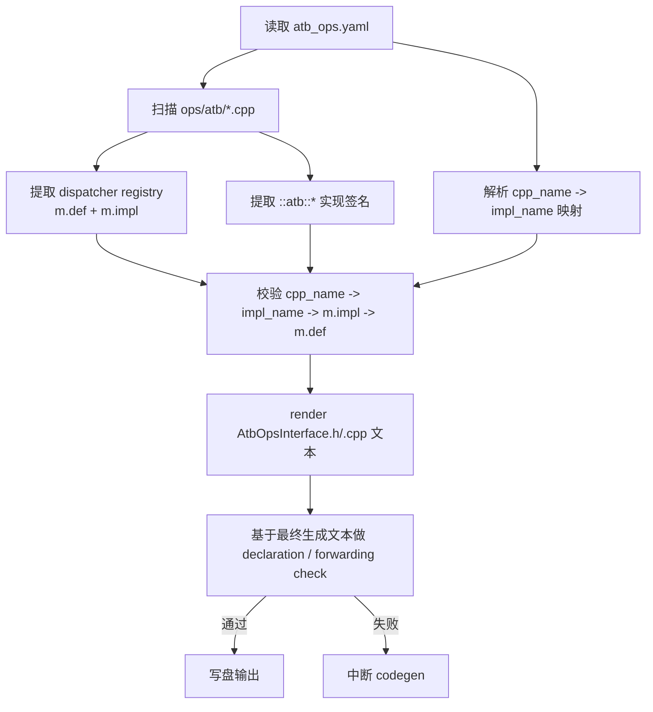

# 1 Story概述（必要）

| 包需求名称 | 设计需求名称 | story名称 | story描述 | 是否做Story设计 |
| ---------- | ------------ | --------- | --------- | --------------- |
| ATB C++接口暴露 | `op-plugin` ATB public C++ ABI 暴露 | ATB C++ Interface Exposure | 将已注册且已映射的 `::atb::*` C++ 实现，通过 `at_npu::native::atb` 暴露为 `libop_plugin_atb.so` 中的 public C++ ABI，并在 codegen 阶段对生成结果执行内置一致性检查。 | 是 |

本特性面向 `torch_npu` 同构环境中的 C++ 调用场景。对外暴露的稳定入口为 `atb_ops.h`、`at_npu::native::atb` 命名空间以及 `libop_plugin_atb.so`。本特性不定义独立 SDK 交付模式，调用方默认处于 `torch_npu`、`libtorch`、`libtorch_python`、`libatb.so` 及相关运行时库组成的完整依赖闭包中。

# 2 Story上下文（必要）

本特性涉及三类输入、一类生成产物和一类对外交付边界。

1. 代码与配置输入
   - `op_plugin/ops/atb/*.cpp`
     - 提供真实 `::atb::*` C++ 实现函数定义。
     - 提供 dispatcher 注册：`m.def(...)` 与 `m.impl(..., TORCH_FN(atb::<impl>))`。
   - `op_plugin/config/atb_ops.yaml`
     - 提供 `cpp_name -> impl_name` 映射。
     - `cpp_name` 固定为全限定名 `at_npu::native::atb::<func>`。

2. 代码生成组件
   - `torchnpugen/gen_atb_ops.py`
     - 读取 yaml。
     - 扫描 ATB cpp 文件。
     - 提取 dispatcher 注册与 `::atb::*` 实现签名。
     - 生成 `AtbOpsInterface.h/.cpp`。
     - 在写盘前对最终生成文本执行内置一致性检查。

3. codegen 生成产物
   - `op_plugin/include/AtbOpsInterface.h`
   - `op_plugin/ops/atb/AtbOpsInterface.cpp`

4. 对外交付边界
   - 头文件入口：`op_plugin/include/atb_ops.h`
   - public C++ namespace：`at_npu::native::atb`
   - public ABI 承载 so：`libop_plugin_atb.so`

5. 运行时依赖边界
   - `libatb.so` 是底层运行时依赖。
   - `libtorch`、`libtorch_python`、`torch_npu` 及相关运行时库属于同构环境依赖闭包。
   - `libop_plugin_atb.so` 是接口归属边界，不是脱离依赖闭包的独立 SDK so。

# 3 功能点分解（必要）

| 序号 | 功能点名称 | 功能点描述 |
| ---- | ---------- | ---------- |
| 1 | public C++ interface 生成 | 根据 `atb_ops.yaml` 映射和 `::atb::*` 真实实现，生成 `at_npu::native::atb` wrapper。 |
| 2 | 暴露集合约束 | 仅对同时满足 yaml 映射和 dispatcher 注册条件的接口生成 public wrapper。 |
| 3 | codegen 内置一致性检查 | 在写盘前对最终生成的 `AtbOpsInterface.h/.cpp` 做一致性检查，阻断错误产物输出。 |

本特性约束如下：

- `cpp_name` 必须为 `at_npu::native::atb::<func>`。
- `impl_name` 必须对应真实 `::atb::*` 实现。
- 对应 `impl_name` 必须在 dispatcher 注册中唯一命中 `m.impl(...)`，且存在对应 `m.def(...)`。
- `AtbOpsInterface.h/.cpp` 为 codegen 生成产物，不作为手工维护文件。

# 4 实现设计（必要）

## 4.1 功能实现思路（必要）

本特性以 `atb_ops.yaml` 和 `ops/atb/*.cpp` 作为输入源，由 `gen_atb_ops.py` 统一完成 public C++ wrapper 生成和生成结果自检。生成器在得到最终 `AtbOpsInterface.h/.cpp` 文本后，先执行内置一致性检查，再写盘输出。



## 4.2 功能实现设计（必要）

`gen_atb_ops.py` 的主流程如下：

1. `load_config`
   - 读取 `atb_ops.yaml`
   - 校验 `functions` 结构
   - 校验 `cpp_name` 前缀并提取 `cpp_short_name`
2. `load_atb_cpp_texts`
   - 加载 `op_plugin/ops/atb/*.cpp`
   - 跳过生成产物 `AtbOpsInterface.cpp`
3. `extract_atb_registry`
   - 提取 `m.def(...)`
   - 提取 `m.impl(..., TORCH_FN(atb::<impl>))`
4. `extract_impl_signature_index`
   - 从真实 `::atb::*` 定义中提取实现签名
5. `validate_config`
   - 校验 `cpp_name -> impl_name -> m.impl -> m.def` 唯一成立
6. `render_outputs`
   - 生成 `header_content`
   - 生成 `source_content`
7. `verify_generated_interface_contract`
   - 对最终生成文本执行内置一致性检查
8. `write_outputs`
   - 检查通过后写盘

生成阶段的内置一致性检查包括：

1. 映射唯一成立
   - `cpp_name` 唯一
   - `impl_name` 唯一命中一个 `m.impl`
   - 对应 dispatcher op 存在唯一 `m.def`
2. `AtbOpsInterface.h` declaration 签名检查
   - 从最终 `header_content` 提取 declaration
   - 与对应 `::atb::*` 实现签名逐项比对
3. `AtbOpsInterface.cpp` forwarding 参数检查
   - 从最终 `source_content` 提取 `::atb::<impl>(...)` 调用参数
   - 与 declaration 参数列表逐项比对

若任一检查失败，`gen_atb_ops.py` 直接输出错误并以非零码退出，不写出错误产物。

### 4.2.1 流程图

本特性流程图见 4.1。

### 4.2.2 流程说明

正常流程：

- yaml 映射、ATB cpp 实现、dispatcher 注册三者一致时，生成器完成 render、自检和写盘。

异常流程：

- `cpp_name` 非法：在 `load_config` 阶段失败。
- `impl_name` 无真实实现：在实现签名提取阶段失败。
- `impl_name` 映射不到唯一 dispatcher op：在 `validate_config` 阶段失败。
- declaration 签名不匹配或 forwarding 参数错位：在最终生成文本检查阶段失败。

## 4.3 数据库及文件持久化设计（可选）

本特性不涉及数据库设计。仅涉及 codegen 输出文件：

- `op_plugin/include/AtbOpsInterface.h`
- `op_plugin/ops/atb/AtbOpsInterface.cpp`

上述文件为生成产物，不属于业务持久化数据。

## 4.4 接口描述（必要）

### 4.4.1 对外接口入口

- 头文件入口：`op_plugin/include/atb_ops.h`
- 命名空间：`at_npu::native::atb`
- 接口承载 so：`libop_plugin_atb.so`

### 4.4.2 用户使用方式

调用方在 `torch_npu` 同构环境中使用这些接口。当前正式推荐的最小复现形态为“Python 进程承载 runtime + 最小 Python C++ extension 调用 C++ wrapper”，而不是纯 C++ 独立 ELF。原因是当前验证环境中的 Python runtime 为静态构建，纯 C++ 独立进程路径不作为正式复现方案。

该复现形态的基本思路如下：

1. 在 Python 层构造固定输入 tensor。
2. 通过现有 Python 暴露接口调用目标 ATB 能力。
3. 构建一个最小 Python C++ extension，在 extension 内部调用 `at_npu::native::atb::_npu_quantize_per_tensor`。
4. 在 Python 层比较两条路径的输出结果，并记录 `PASS/FAIL`。

该复现形态验证的是：

- `atb_ops.h` 和 `at_npu::native::atb` wrapper 接口可在同构环境中被 C++ 代码实际调用
- C++ wrapper 路径与现有 Python 暴露接口路径在相同输入下输出一致

该复现形态不证明：

- 外部用户可以仅依赖 `atb_ops.h` 和 `libop_plugin_atb.so` 独立构建纯 C++ 程序
- 当前接口具备独立 SDK 式分发消费能力

### 4.4.3 产物范围

本特性的产物范围分为三层：

1. 配置输入
   - `atb_ops.yaml`
2. 生成产物
   - `AtbOpsInterface.h`
   - `AtbOpsInterface.cpp`
3. 对外交付边界
   - `atb_ops.h`
   - `libop_plugin_atb.so`

### 4.4.4 依赖边界

- `libop_plugin_atb.so` 是 ATB public C++ ABI 的承载边界。
- `libop_plugin_atb.so` 不是可脱离依赖闭包独立消费的 SDK so。
- `libatb.so` 是底层运行时依赖，不是直接面向用户的 public ABI。

根据 `ldd libop_plugin_atb.so` 的结果，`libop_plugin_atb.so` 至少存在以下关键依赖：

```text
libtorch_npu.so => ./libtorch_npu.so
libatb.so => not found
libtorch_python.so => not found
libtorch.so => not found
libtorch_cpu.so => not found
libc10.so => not found
```

这说明 `libop_plugin_atb.so` 的可编译、可链接、可装载都依赖 `torch_npu` 同构环境中的完整依赖闭包。测试或用户环境若缺少这些库，会在链接或装载阶段失败。

### 4.4.5 接口映射关系

下表展示当前预期暴露的 ATB 接口在实现层、public C++ wrapper 层和 Python 暴露层的对应关系。Python 暴露入口采用混合入口形式，当前分组以 [\_atb_ops.py](/D:/Atomgit/Ascend/op-plugin/op_plugin/python/atb/_atb_ops.py) 中的 `API_LIST` 和 `ATB_API_LIST` 为准：

- `API_LIST` 中的接口暴露为 `torch_npu.<func>`
- `ATB_API_LIST` 中的接口暴露为 `torch_npu.atb.<func>`

`atb_ops.yaml` 中的映射形式如下：

```yaml
functions:
  - cpp_name: "at_npu::native::atb::_npu_group_topk"
    impl_name: "atb::_npu_group_topk"

  - cpp_name: "at_npu::native::atb::npu_paged_cache_load"
    impl_name: "atb::npu_paged_cache_load"
```

对于 Python 层的 overload packet 暴露，不要求每个 `.out`、`.lse`、`.lse_out` 变体都单独对应一个 Python 名字。

| ATB C++ 实现接口 | public wrapper 接口 | Python 暴露入口 | 说明 |
| --- | --- | --- | --- |
| `::atb::_npu_paged_attention_quant` | `at_npu::native::atb::_npu_paged_attention_quant` | `torch_npu._npu_paged_attention_quant` | 基础接口，一对一暴露。 |
| `::atb::npu_fused_add_topk_div` | `at_npu::native::atb::npu_fused_add_topk_div` | `torch_npu.atb.npu_fused_add_topk_div` | 基础接口。 |
| `::atb::npu_fused_add_topk_div_out` | `at_npu::native::atb::npu_fused_add_topk_div_out` | `torch_npu.atb.npu_fused_add_topk_div` | 通过同一 Python 基础接口暴露，`out` 语义由参数触发。 |
| `::atb::_npu_group_topk` | `at_npu::native::atb::_npu_group_topk` | `torch_npu._npu_group_topk` | 基础接口，一对一暴露。 |
| `::atb::_npu_matmul_add_fp32` | `at_npu::native::atb::_npu_matmul_add_fp32` | `torch_npu._npu_matmul_add_fp32` | 基础接口，一对一暴露。 |
| `::atb::npu_mla_preprocess` | `at_npu::native::atb::npu_mla_preprocess` | `torch_npu.atb.npu_mla_preprocess` | 基础接口。 |
| `::atb::npu_mla_preprocess_out` | `at_npu::native::atb::npu_mla_preprocess_out` | `torch_npu.atb.npu_mla_preprocess` | `out` 变体通过同一 Python 基础接口暴露。 |
| `::atb::npu_multi_head_latent_attention` | `at_npu::native::atb::npu_multi_head_latent_attention` | `torch_npu.atb.npu_multi_head_latent_attention` | 基础接口。 |
| `::atb::npu_multi_head_latent_attention_out` | `at_npu::native::atb::npu_multi_head_latent_attention_out` | `torch_npu.atb.npu_multi_head_latent_attention` | `out` 变体通过同一 Python 基础接口暴露。 |
| `::atb::npu_multi_head_latent_attention_lse` | `at_npu::native::atb::npu_multi_head_latent_attention_lse` | `torch_npu.atb.npu_multi_head_latent_attention` | `lse` 变体通过同一 Python 基础接口暴露。 |
| `::atb::_npu_multi_head_latent_attention_lse_get_workspace` | `at_npu::native::atb::_npu_multi_head_latent_attention_lse_get_workspace` | `torch_npu.atb._npu_multi_head_latent_attention_get_workspace` | workspace getter 单独暴露，Python 名字按基础 getter 提供。 |
| `::atb::npu_multi_head_latent_attention_lse_out` | `at_npu::native::atb::npu_multi_head_latent_attention_lse_out` | `torch_npu.atb.npu_multi_head_latent_attention` | `lse_out` 变体通过同一 Python 基础接口暴露。 |
| `::atb::_npu_paged_attention` | `at_npu::native::atb::_npu_paged_attention` | `torch_npu._npu_paged_attention` | 基础接口，一对一暴露。 |
| `::atb::_npu_paged_attention_get_workspace` | `at_npu::native::atb::_npu_paged_attention_get_workspace` | `torch_npu._npu_paged_attention_get_workspace` | workspace getter，一对一暴露。 |
| `::atb::_npu_paged_attention_v2` | `at_npu::native::atb::_npu_paged_attention_v2` | `torch_npu.atb._npu_paged_attention_v2` | 基础接口。 |
| `::atb::_npu_paged_attention_v2_get_workspace` | `at_npu::native::atb::_npu_paged_attention_v2_get_workspace` | `torch_npu.atb._npu_paged_attention_v2_get_workspace` | workspace getter。 |
| `::atb::_npu_paged_attention_mla` | `at_npu::native::atb::_npu_paged_attention_mla` | `torch_npu._npu_paged_attention_mla` | 基础接口，一对一暴露。 |
| `::atb::_npu_paged_attention_splitfuse` | `at_npu::native::atb::_npu_paged_attention_splitfuse` | `torch_npu._npu_paged_attention_splitfuse` | 基础接口，一对一暴露。 |
| `::atb::npu_paged_cache_load_out` | `at_npu::native::atb::npu_paged_cache_load_out` | `torch_npu.atb.npu_paged_cache_load` | `out` 变体通过同一 Python 基础接口暴露。 |
| `::atb::npu_paged_cache_load` | `at_npu::native::atb::npu_paged_cache_load` | `torch_npu.atb.npu_paged_cache_load` | 基础接口。 |
| `::atb::_npu_quantize_per_tensor` | `at_npu::native::atb::_npu_quantize_per_tensor` | `torch_npu._npu_quantize_per_tensor` | 基础接口，一对一暴露。 |
| `::atb::_npu_quant_rms_norm` | `at_npu::native::atb::_npu_quant_rms_norm` | `torch_npu._npu_quant_rms_norm` | 基础接口，一对一暴露。 |
| `::atb::_npu_reshape_and_cache` | `at_npu::native::atb::_npu_reshape_and_cache` | `torch_npu._npu_reshape_and_cache` | 基础接口，一对一暴露。 |
| `::atb::_npu_reshape_and_cache_siso` | `at_npu::native::atb::_npu_reshape_and_cache_siso` | `torch_npu._npu_reshape_and_cache_siso` | 基础接口，一对一暴露。 |
| `::atb::npu_ring_mla` | `at_npu::native::atb::npu_ring_mla` | `torch_npu.atb.npu_ring_mla` | 基础接口。 |
| `::atb::npu_ring_mla_out` | `at_npu::native::atb::npu_ring_mla_out` | `torch_npu.atb.npu_ring_mla` | `out` 变体通过同一 Python 基础接口暴露。 |
| `::atb::_npu_rotary_embedding` | `at_npu::native::atb::_npu_rotary_embedding` | `torch_npu._npu_rotary_embedding` | 基础接口，一对一暴露。 |
| `::atb::_npu_flash_attention` | `at_npu::native::atb::_npu_flash_attention` | `torch_npu._npu_flash_attention` | 基础接口，一对一暴露。 |
| `::atb::_npu_flash_attention_v2` | `at_npu::native::atb::_npu_flash_attention_v2` | `torch_npu.atb._npu_flash_attention_v2` | 基础接口。 |
| `::atb::_npu_flash_attention_prefix_v2` | `at_npu::native::atb::_npu_flash_attention_prefix_v2` | `torch_npu.atb._npu_flash_attention_prefix_v2` | 基础接口。 |
| `::atb::npu_self_attention_prefix_encoder` | `at_npu::native::atb::npu_self_attention_prefix_encoder` | `torch_npu.atb.npu_self_attention_prefix_encoder` | 基础接口。 |
| `::atb::npu_self_attention_prefix_encoder_out` | `at_npu::native::atb::npu_self_attention_prefix_encoder_out` | `torch_npu.atb.npu_self_attention_prefix_encoder` | `out` 变体通过同一 Python 基础接口暴露。 |
| `::atb::_npu_flash_attention_qlens` | `at_npu::native::atb::_npu_flash_attention_qlens` | `torch_npu._npu_flash_attention_qlens` | 基础接口，一对一暴露。 |
| `::atb::_npu_flash_attention_unpad` | `at_npu::native::atb::_npu_flash_attention_unpad` | `torch_npu._npu_flash_attention_unpad` | 基础接口，一对一暴露。 |

说明：

1. `ATB C++ 实现接口` 对应 `ops/atb/*.cpp` 中的真实 `::atb::*` 实现。
2. `public wrapper 接口` 对应 `at_npu::native::atb::*`，由 `gen_atb_ops.py` 生成。
3. `Python 暴露入口` 以 [\_atb_ops.py](/D:/Atomgit/Ascend/op-plugin/op_plugin/python/atb/_atb_ops.py) 的 patch 结果为准，当前是 `torch_npu.*` 与 `torch_npu.atb.*` 的混合入口。
4. 对于 `.out`、`.lse`、`.lse_out` 等变体，Python 层采用 overload packet 归并暴露，这类接口应视为“已通过对应基础 Python 接口暴露”。

## 4.5 GUI界面（可选）

本特性不涉及 GUI 或前端交互。

## 4.6 代码设计（必要）

关键组件职责如下：

- `atb_ops.yaml`
  - 维护全限定 `cpp_name -> impl_name` 映射
- `gen_atb_ops.py`
  - 负责扫描、校验、生成、内置一致性检查
- `AtbOpsInterface.h/.cpp`
  - 作为 `at_npu::native::atb` public C++ wrapper 生成产物
- `ops/atb/*.cpp`
  - 提供真实 `::atb::*` 实现与 dispatcher 注册

# 5 DFx设计（可选）

## 5.1 性能设计

本特性不新增运行时算子逻辑，不改变 `::atb::*` 算子执行路径。新增开销位于 codegen 阶段：

- 扫描 `ops/atb/*.cpp`
- render 生成文本
- 对最终生成文本执行一次内置一致性检查

运行时无额外业务路径开销。

## 5.2 安全设计

本特性不新增网络访问、数据库访问或敏感数据持久化。安全影响主要体现在：

- 不改动已有 `::atb::*` 业务逻辑
- 不新增额外运行时执行分支，仅新增接口暴露与生成校验

## 5.3 兼容性设计

兼容性原则如下：

- 不改变 `::atb::*` 真实实现签名
- public wrapper 由生成器稳定生成
- `cpp_name` 规范固定为 `at_npu::native::atb::<func>`
- 调用边界固定为 `atb_ops.h` + `libop_plugin_atb.so`

## 5.4 全球化

本特性不涉及多语言界面或区域化逻辑。

## 5.5 日志上报、BI、曝光性及可维护性

本特性不新增 BI、曝光或日志上报接口。可维护性设计主要体现在：

- codegen 阶段固定输入与输出边界
- 生成阶段的内部一致性保障会在错误产物写盘前直接失败

# 6 测试设计（必要）

## 6.1 单元测试（UT）

本特性不以独立 parser 单测或生成器内部白盒校验作为主要验收方式。正式验收以接口暴露结果的黑盒验证为主。

## 6.2 接口测试

测试人员从外部接口视角验证以下内容：

1. 头文件可见性
   - `atb_ops.h` 可作为公开入口被包含
2. 命名空间可见性
   - `at_npu::native::atb` 下目标接口可见
3. 接口承载位置
   - public C++ interface 归属 `libop_plugin_atb.so`
4. 同构环境下的最小复现工程构建与装载验证
   - 准备 `torch_npu` 同构环境
   - 准备与 `torch.compiled_with_cxx11_abi()` 匹配的真实 NNAL `libatb.so`
   - 构建一个最小 Python C++ extension，并在 extension 内部调用 `at_npu::native::atb::_npu_quantize_per_tensor`
   - 在 Python 进程中导入该 extension，并完成对比执行
   - 不将“仅链接 `libop_plugin_atb.so`”作为验收口径

若缺少 `torch_npu`、`libtorch`、真实 NNAL `libatb.so` 或相关运行时库，导致复现工程无法构建、装载或运行，应判定为“环境依赖不完整”，而不是“接口未暴露”。

## 6.3 业务场景测试

本特性的业务场景测试为“同构环境内的 C++ wrapper 可用性验证”。当前采用 `_npu_quantize_per_tensor` 作为代表性接口，复现步骤如下：

1. 在 Python 层构造固定输入：
   - `input_x`：`float16`，shape `1x4x4`
   - `scale`：`float16`，shape `4x4`，全 `0.5`
   - `offset`：`int8`，shape `4x4`，全 `1`
2. Python 基准路径调用：
   - `torch.ops.atb._npu_quantize_per_tensor`
3. C++ wrapper 路径调用：
   - 最小 Python C++ extension 内部调用 `at_npu::native::atb::_npu_quantize_per_tensor`
4. 将两条路径输出搬回 CPU，并对 `int8` 输出做逐元素完全一致比较
5. 打印或记录：
   - `input_x`
   - `scale`
   - `offset`
   - Python 路径结果
   - C++ wrapper 路径结果
   - `PASS/FAIL`

该验证可以证明：

- 同构环境内可基于暴露的 C++ wrapper 进行开发和调用
- C++ wrapper 路径与现有 Python 暴露接口路径行为一致

该验证不证明：

- 可以脱离 Python/runtime 依赖闭包独立开发纯 C++ 可执行程序
- 当前接口具备独立 SDK 式消费能力

## 6.4 异常场景测试

测试人员从黑盒角度验证以下异常场景：

1. 头文件不可见
   - `atb_ops.h` 无法包含，说明接口入口未正确交付
2. 同构环境依赖不完整导致链接失败
   - 缺失 `libtorch`、`torch_npu` 或相关运行时库时，最小复现工程无法完成构建、链接或装载
3. 运行时依赖缺失导致装载失败
   - `libatb.so => not found` 时，程序装载失败，归因于底层运行时依赖缺失
   - `libtorch_python.so => not found` 时，程序装载失败，归因于 PyTorch Python runtime 依赖缺失
   - 若加载的是 repo stub `libatb.so` 而不是真实 NNAL `libatb.so`，会出现运行时符号缺失，应判定为运行时依赖选择错误
4. libtorch 依赖闭包不完整
   - `libtorch.so`、`libtorch_cpu.so`、`libc10.so => not found` 时，程序会在链接或装载阶段失败，归因于 libtorch 依赖闭包不完整
5. ABI 不匹配
   - 若 `libatb.so` 与 `torch.compiled_with_cxx11_abi()` 对应的 ABI 不匹配，应判定为运行时依赖选择错误
6. 环境满足时暴露可用，环境不满足时可归因
   - 当依赖闭包完整时，接口可见、可链接、可装载、可最小调用
   - 当依赖闭包不完整时，失败原因应归因于运行环境依赖，而不是接口命名或暴露边界本身

生成阶段的 codegen 内置一致性检查属于开发期和构建期保障，用于尽早失败，不作为测试人员黑盒验收的主路径。
